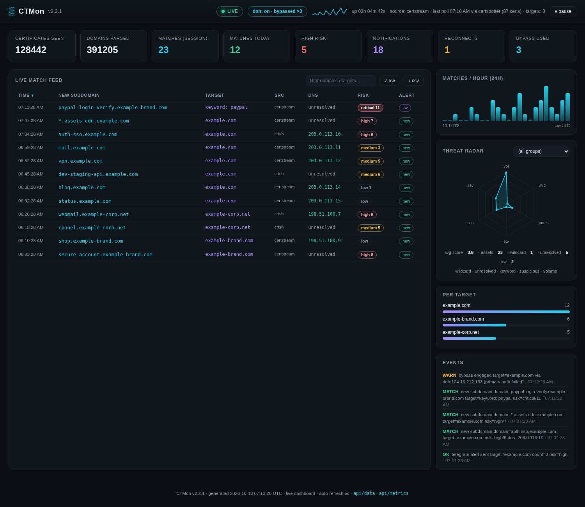

<h1 align="center">
<a href="#"></a>
</h1>

<h1 align="center">CTMon</h1>

<p align="center">
<a href="#requirements"></a>
<a href="LICENSE"></a>
<a href="#the-dashboard"></a>


</p>

```text
░█▀▀░ ░▀█▀░ ░█▄█░ ░█▀█░ ░█▀█░
░█░░░ ░░█░░ ░█░█░ ░█░█░ ░█░█░
░▀▀▀░ ░░▀░░ ░▀░▀░ ░▀▀▀░ ░▀░▀░
 monitor your targets, hunt fresh assets in real time!
```

**CTMon** is a zero-dependency PowerShell remake of [coffinxp/crtmon](https://github.com/coffinxp/crtmon)
that watches **Certificate Transparency logs in real time** (certstream WebSocket), matches newly
issued subdomains against your bug bounty targets, resolves them to IPs, scores their risk, and
pushes instant alerts to **Telegram / Discord / Slack / ntfy / webhook** — with a built-in
**dark-mode live dashboard** and a **network bypass engine** that keeps monitoring alive when
your VPN drops or your ISP blocks CT sites.

---

## Highlights

|                       |                                                                                                                                                                             |
| --------------------- | --------------------------------------------------------------------------------------------------------------------------------------------------------------------------- |
| **Real-time CT feed** | certstream WebSocket with silent-feed watchdog, auto-reconnect and multi-feed failover                                                                                      |
| **Polling sources**   | `crt.sh` JSON API and the **Cert Spotter** alternative API (`-Source certspotter`)                                                                                          |
| **Net bypass engine** | crt.sh unreachable? auto-retry via **proxy → DNS-over-HTTPS + curl --resolve → Cert Spotter**, every detour logged to the dashboard                                         |
| **Risk scoring**      | every match scored (wildcard / brand keyword / suspicious terms / unresolved DNS / subdomain depth) → `low · medium · high · critical` badges in alerts, feed and dashboard |
| **Live dashboard**    | dark-mode HTML, live feed with sort/filter, sparkline, threat radar, CSV export, keyword highlight — no CDN, no Node, no admin rights                                       |
| **Metrics**           | Prometheus `GET /api/metrics` — drop CTMon into Grafana                                                                                                                     |
| **Notifications**     | Telegram (grouped, 4096-char safe), Discord embeds, **Slack**, **ntfy push**, generic JSON webhook                                                                          |
| **Weekly digest**     | "top new assets" recap pushed through your channel every Monday morning                                                                                                     |
| **DNS enrichment**    | new subdomains resolved to IPs, cached 7 days, DoH fallback when the local resolver is blocked                                                                              |
| **24/7 mode**         | detached background process, Windows Scheduled Task, systemd unit, restart-safe dedup                                                                                       |

---

- **Bypass engine** — when crt.sh times out or is blocked (VPN off), CTMon retries through the configured
  proxy, then through DNS-over-HTTPS + `curl --resolve`, then fails over to Cert Spotter. Bypass events
  land in the dashboard event feed and a `bypass used` counter.
- **Risk scoring** — `low / medium / high / critical` on every match, colored badges in the dashboard feed
  and severity lines in Telegram/Discord/Slack alerts.
- **Slack + ntfy channels** — `notify = slack` or `notify = ntfy`.
- **Prometheus metrics** — `GET /api/metrics` on the dashboard server.
- **Weekly digest** — per-target recap of the week's new assets (`-Digest` to send on demand).
- **Dashboard power-ups** — 24h sparkline, threat radar per target, sortable feed columns, one-click CSV
  download, keyword highlight toggle.
- Prettier terminal: three-tone banner, boxed session summary, bypass-aware status lines.
- Self-test suite grew to **84 checks** (`-SelfTest`).

---

## Requirements

- **Windows PowerShell 5.1** (built into Windows) or **PowerShell 7+** — Windows, Linux, macOS
- Internet access. **No modules, no dependencies** — WebSocket client, HTTP server, DNS and DoH are all .NET built-ins (`curl` optional, for SOCKS proxies on PS 5.1).

## Quick start

```powershell
# 1) install (optional helper)
.\Install-CTMon.ps1

# 2) configure secrets + targets (wizard writes .env for you)
.\CTMon.ps1 -Setup

# 3) verify delivery
.\CTMon.ps1 -TestAlert

# 4) monitor + dashboard
.\CTMon.ps1 -Target example.com -Background -ServeBg
#    open http://127.0.0.1:8080/

.\CTMon.ps1 -Status      # what's running?
.\CTMon.ps1 -Doctor      # diagnose config, PID, dashboard health
.\CTMon.ps1 -Stop        # stop everything
```

<details>
<summary>Getting a Telegram bot token (30 seconds)</summary>

1. Open **@BotFather** in Telegram → `/newbot` → copy the HTTP API token.
2. Send any message to your new bot (press **START**).
3. Open `https://api.telegram.org/bot<TOKEN>/getUpdates` and read `"chat":{"id":123456789}`.
4. Put token + chat id into `.env` (or just run `-Setup`).

</details>

## Net bypass (VPN off / crt.sh blocked)

Set a proxy once and forget about it:

```ini
# .env
HTTPS_PROXY=socks5://127.0.0.1:9050     # http:// and https:// work too
```

```jsonc
// config.json
"net_bypass": true,        // master switch (default on)
"doh_enabled": true,       // DNS-over-HTTPS fallback (default on)
"doh_provider": "cloudflare",   // cloudflare | google | auto
"certspotter_token": ""    // optional, raises the free rate limit
```

When a crt.sh poll fails, CTMon walks the chain automatically and shows which path won:

```
crt.sh direct/proxy  ──fail──▶  DoH (1.1.1.1) + curl --resolve  ──fail──▶  Cert Spotter API
```

DNS enrichment uses the same DoH fallback, so names poisoned at the ISP level still resolve.
Every engagement is logged (`bypass engaged ... via doh:104.16.x.x`) and counted in the dashboard.

## The dashboard

```powershell
.\CTMon.ps1 -ServeBg                  # detached live server
.\CTMon.ps1 -ServeBg -Port 8081       # explicit port
.\CTMon.ps1 -Serve                    # foreground (Ctrl+C to stop)
.\CTMon.ps1 -Dashboard                # static snapshot file
.\CTMon.ps1 -Status                   # incl. dashboard health
```

Live mode serves `GET /` (the UI), `GET /api/data`, `GET /api/health` and
`GET /api/metrics` (Prometheus text format) with CORS enabled — build your own widgets on top.
The server is a raw `TcpListener`: no admin rights, no URL ACLs, identical on PS 5.1 / PS 7 / Linux.
It binds to `127.0.0.1` by default because the feed is recon data; changing `-Bind` prints a warning.

UI: LIVE/OFFLINE/SNAPSHOT pill · net-bypass pill (proxy/DoH/bypassed×N) · 24h sparkline ·
8 stat cards (incl. **high risk** and **bypass used**) · live feed with **sortable columns**, text
filter, **keyword highlight** and **CSV download** · severity badges · matches/hour bars ·
**threat radar** per target (volume / wildcard / unresolved / keyword / suspicious) · per-target
bars · event log · pause.

## Notifications

```ini
# .env
TELEGRAM_BOT_TOKEN=123456789:AAE_...
TELEGRAM_CHAT_ID=123456789
DISCORD_WEBHOOK_URL=https://discord.com/api/webhooks/...
SLACK_WEBHOOK_URL=https://hooks.slack.com/services/...
NTFY_TOPIC=my-hard-to-guess-topic
NTFY_SERVER=https://ntfy.sh
GENERIC_WEBHOOK_URL=https://your-endpoint/hook
```

```jsonc
// config.json
"notify": "telegram"   // telegram | discord | slack | ntfy | webhook | none
```

- **Telegram** — grouped `target [N]` embeds, single-domain alerts include the resolved IP and the
  risk line, 4096-char safe chunking, `retry_after` handling.
- **Discord / Slack** — embed/plain-text alerts colored by worst severity in the batch.
- **ntfy** — push notification with priority escalation for high/critical matches.
- **Generic webhook** — JSON `{ "text": "...", "ctmon": { target, count, domains, severity, source, ts } }`.

## Weekly digest

```powershell
.\CTMon.ps1 -Digest                    # build + send now (-Days N, -Notify channel)
```

```jsonc
"digest_enabled": true, "digest_weekday": "Monday", "digest_hour": 9, "digest_days": 7
```

The monitor sends the recap through your configured channel automatically (default: Monday 09:00
local, only when there were matches, at most once every 6 days).

## Management & utility commands

| Command                                                 | What it does                                                       |
| ------------------------------------------------------- | ------------------------------------------------------------------ |
| `-Target example.com`                                   | monitor one domain (also: comma list, array, file path, `-` stdin) |
| `-Source certstream\|crtsh\|certspotter`                | data source (config `source` is the default)                       |
| `-Notify telegram\|discord\|slack\|ntfy\|webhook\|none` | notification channel                                               |
| `-Setup`                                                | wizard: Telegram token/chat id → **.env**, targets, keywords       |
| `-TestAlert`                                            | send a test message through the configured channel                 |
| `-Background` / `-Stop` / `-Status`                     | 24/7 lifecycle                                                     |
| `-Background -ServeBg`                                  | start the monitor and dashboard with one command                   |
| `-Doctor`                                               | local config/process/port/health diagnostics (offline)             |
| `-Serve` / `-ServeBg` / `-Dashboard`                    | dashboard: live server / detached / static file                    |
| `-Port N` / `-Bind IP`                                  | dashboard port (default env/config/8080) and bind address          |
| `-Export -Format csv\|json -Days N -OutFile path`       | export match history                                               |
| `-Summary -Days N`                                      | per-target / per-day / DNS-ratio report                            |
| `-Digest -Days N`                                       | weekly digest on demand                                            |
| `-Prune -Days N`                                        | trim history, stale DNS cache entries, old logs (default 90 d)     |
| `-SelfTest`                                             | built-in regression checks (84) — run after any config change      |
| `-DryRun`                                               | detect matches, log them, send nothing                             |
| `-Version` / `-Help`                                    | version / usage screen                                             |

## Configuration

`~/.config/ctmon/config.json` (all keys optional — defaults on first run):

| Key                                                                 | Default                       | Notes                                                            |
| ------------------------------------------------------------------- | ----------------------------- | ---------------------------------------------------------------- |
| `targets`                                                           | `[]`                          | suffix match — `vercel.app` also watches `*.vercel.app`          |
| `keywords`                                                          | `[]`                          | alert when the keyword appears in ANY new certificate            |
| `notify`                                                            | `telegram`                    | `telegram` / `discord` / `slack` / `ntfy` / `webhook` / `none`   |
| `source`                                                            | `certstream`                  | or `crtsh`, `certspotter`                                        |
| `certstream_urls`                                                   | calidog + cert.ee             | local docker server goes first here                              |
| `certstream_fallback_minutes`                                       | `10`                          | auto-switch to crt.sh polling after N min of dead feed (0 = off) |
| `net_proxy` / `net_bypass`                                          | `''` / `true`                 | proxy url (env `HTTPS_PROXY` wins) / bypass chain switch         |
| `doh_enabled` / `doh_provider`                                      | `true` / `cloudflare`         | DoH fallback (`cloudflare` / `google` / `auto`)                  |
| `certspotter_token`                                                 | `''`                          | optional API token (env `CERTSPOTTER_TOKEN` wins)                |
| `metrics_enabled`                                                   | `true`                        | expose `GET /api/metrics`                                        |
| `digest_enabled` / `digest_weekday` / `digest_hour` / `digest_days` | `true` / `Monday` / `9` / `7` | weekly recap                                                     |
| `enrich_dns`                                                        | `true`                        | resolve new subdomains to IPs (+ DoH fallback)                   |
| `dashboard_enabled` / `dashboard_port` / `dashboard_bind`           | `true` / `8080` / `127.0.0.1` | dashboard                                                        |
| `include_wildcards`                                                 | `true`                        | include `*.foo.target` SAN entries                               |
| `exclude_regex`                                                     | `[]`                          | exclusion regexes, win over everything                           |
| `flush_interval_seconds` / `batch_max_domains`                      | `10` / `10`                   | alert batching                                                   |
| `remember_seen` / `seen_max_entries`                                | `true` / `50000`              | never re-alert after restart                                     |
| `matches_history_max`                                               | `20000`                       | dashboard/export history cap                                     |
| `crtsh_interval_seconds` / `crtsh_window_minutes`                   | `300` / `1440`                | crt.sh polling                                                   |
| `certstream_silent_timeout_seconds`                                 | `90`                          | silent-feed watchdog                                             |
| `heartbeat_hours`                                                   | `6`                           | "still alive" message (0 = off)                                  |
| `log_to_file` / `log_level` / `stats_summary`                       | `true` / `INFO` / `true`      | logging                                                          |

## State files

```
~/.config/ctmon/
├── config.json           configuration
├── .env                  optional secrets (also supported next to CTMon.ps1)
├── state.json            last session stats (feeds -Status and offline dashboard)
├── seen.json             persistent seen-history (restart-safe de-dup)
├── matches.jsonl         match history (dashboard feed, -Export, -Summary, digest)
├── dns-cache.json        DNS enrichment cache
├── dashboard.html        dark-mode dashboard (static/self-contained)
├── dashboard-data.json   dashboard data (live endpoint cache)
├── ctmon.pid             running monitor pid
├── ctmon-serve.pid       running dashboard server pid
└── logs/ctmon-*.log      daily log files
```

## Troubleshooting

- **Dashboard/feed is empty** → that usually just means **no new certificate was issued for your
  target inside the window** (default: last 24 h). Big corporate domains like `delltechnologies.com`
  often issue nothing for days — CTMon is doing its job, there is simply nothing new to report.
  Verify with a 30-day backfill: `.\CTMon.ps1 -Stop` then
  `.\CTMon.ps1 -Target delltechnologies.com -Source crtsh -WindowMinutes 43200 -DryRun`
  and you will see real matches immediately. For a lively demo, use high-churn shared platforms
  (`vercel.app`, `pages.dev`, `netlify.app`, `herokuapp.com`, `workers.dev`, `github.io`) or watch
  a brand keyword (`"keywords": ["paypal"]`) — those get new certificates every few minutes.
- **Platform domains (vercel.app etc.) fail on polling sources** → this is expected: crt.sh
  buckles under the `%.vercel.app` query (HTTP 502) and the Cert Spotter free plan refuses
  registrar-owned domains (HTTP 403). Use the **real-time feed** for them instead — it queries
  nothing and just watches the stream: `.\CTMon.ps1 -Target vercel.app` (certstream is the
  default source). Polling sources are for normal registered domains.
- **No alerts** → `.\CTMon.ps1 -TestAlert`; check `.env` (`-Status` shows the resolved secret source);
  make sure you pressed START in the bot chat.
- **Public certstream blocked/silent** (connect fails or handshake drops = ISP interference) →
  set `HTTPS_PROXY` in `.env` — v2.2.3 routes the WebSocket through it — or let CTMon auto-switch
  to crt.sh polling after 10 minutes (`certstream_fallback_minutes`). You can also run your own
  server in Docker (`docker run -d --name certstream -p 8888:8888 ghcr.io/tinker-security/certstream-server-go:latest`,
  then `"certstream_urls": ["ws://127.0.0.1:8888/"]`) or use `-Source crtsh` / `-Source certspotter`.
- **crt.sh blocked / VPN off** → set `HTTPS_PROXY` in `.env` (Tor: `socks5://127.0.0.1:9050`); the
  bypass chain handles the rest and `-Doctor` shows what is armed.
- **SOCKS proxy on PS 5.1** → CTMon routes through `curl.exe` automatically (ships with Windows 10+).
- **Dashboard port busy** → default/configured ports fall forward through the next 20 ports;
  `-ServeBg -Port 8081` pins one, `-Doctor` / `-Status` diagnose.
- **PS 5.1 + TLS errors** → CTMon enables TLS 1.2 automatically; check corporate proxies.
- **Everything else** → `-Doctor`, then `-SelfTest`, then `logs/ctmon-<date>.log`.

## Credits & inspiration

- **[coffinxp/crtmon](https://github.com/coffinxp/crtmon)** — the original tool and the article this project remakes
- **[jonaslejon/ct-monitor](https://github.com/jonaslejon/ct-monitor)** — DNS resolution of discovered domains
- **[yassineaboukir/Sublert](https://github.com/yassineaboukir/Sublert)** — working-subdomain checks, scheduled monitoring
- **[ProtonMail/ct-monitor](https://github.com/ProtonMail/ct-monitor)** — persistent CT change history
- **[trickest/ctFESS](https://github.com/trickest/ctFESS)** — keyword surveillance
- **[chris408/certstream-suspicious](https://github.com/chris408/certstream-suspicious)** — suspicious keyword heuristics
- **[Calidog certstream](https://certstream.calidog.io/)** — the real-time CT feed protocol
- **[Cert Spotter](https://sslmate.com/certspotter/)** — alternative CT log search API

## License

MIT — see [LICENSE](LICENSE).

**Disclaimer:** for educational and authorized security research only. Monitor only assets you
own or have permission to test.
